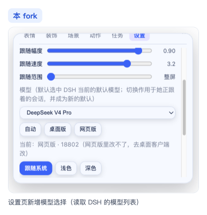
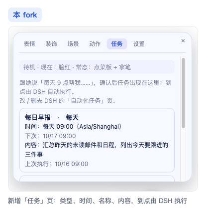
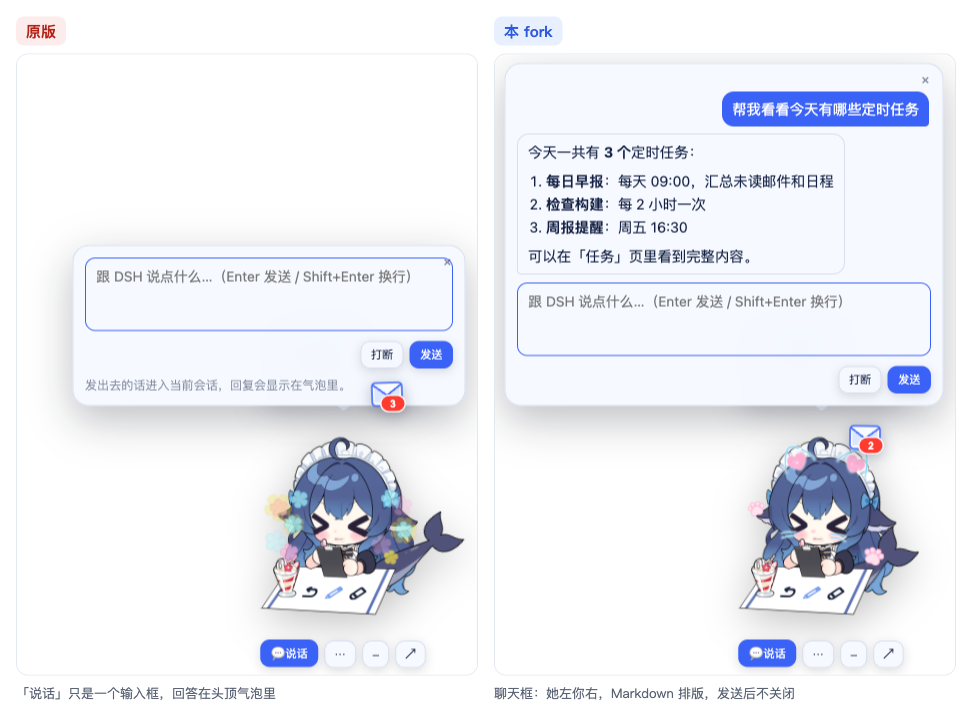
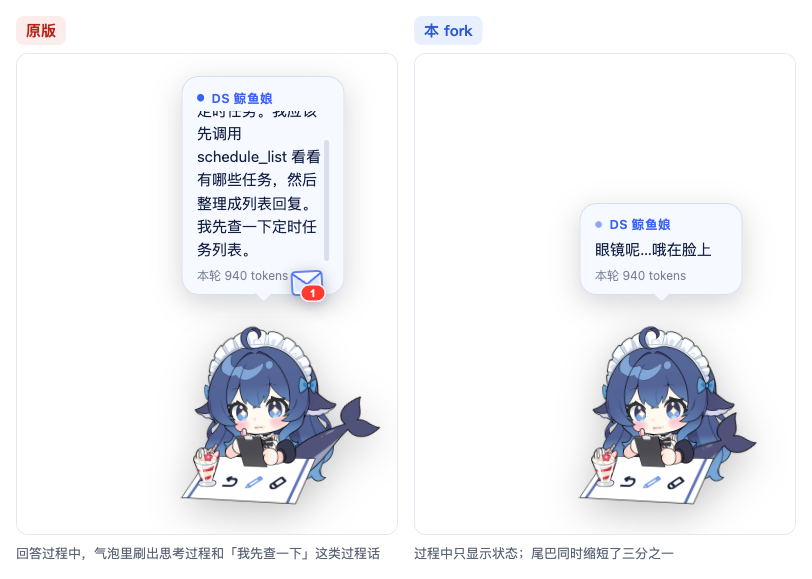
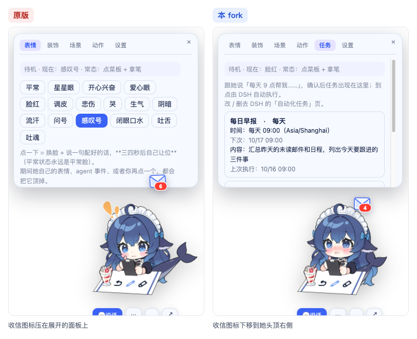

# 🐋 鲸鱼娘桌宠 · Whale Girl Live2D（JarryK fork）

> 这是 [Andersen216/dsh-whale-girl-live2d](https://github.com/Andersen216/dsh-whale-girl-live2d) 的 fork。
> 本页只介绍 fork 的改动；安装、使用、配置、排错等完整说明见下面的链接。
> 基线：上游 `cfaa7cd`（0.4.6）。适配 DSH 桌面版 `0.2.0-rc.2`。

| 想看 | 去哪里 |
|---|---|
| 完整使用说明（本 fork 版，含「约束文件」一节） | [`README.original.md`](README.original.md) |
| 上游原版代码（fork 时的版本 `cfaa7cd`） | [Andersen216/dsh-whale-girl-live2d @ cfaa7cd](https://github.com/Andersen216/dsh-whale-girl-live2d/tree/cfaa7cd03ca21ab6a4a5e44a7b23ff2072d3bbf6) |
| 上游原版 README（fork 时的版本） | [README.md @ cfaa7cd](https://github.com/Andersen216/dsh-whale-girl-live2d/blob/cfaa7cd03ca21ab6a4a5e44a7b23ff2072d3bbf6/README.md) |
| 上游最新版 | [Andersen216/dsh-whale-girl-live2d](https://github.com/Andersen216/dsh-whale-girl-live2d) |

> 📷 本页截图来自本地演示：真插件代码 + 模拟的 DSH 服务和对话数据，原版（`cfaa7cd`）和本 fork 用同一段对话在浏览器里分别渲染。
> 截图里的任务、模型、对话内容都是演示数据。

在上游 0.4.6 的基础上，这个 fork 改了三类东西：

- **安全加固**：加了一份约束配置文件，桌面壳连接前要先握手，部署时锁定版本。
- **新功能**：选模型、定时任务页、聊天框。
- **体验修复**：一批桌宠使用上的问题。

---

## 一、安全加固

### 1. 约束配置文件 `~/.dsh/dsh-live2d-pet.policy.json`

参照 DSH（Harness）的做法，把「插件能做什么」单独写进一份 JSON。插件、macOS 壳、Windows 壳都读这一份。插件第一次启动时会生成默认文件，默认值和以前的行为一致：

```json
{
  "routes": { "say": true, "cancel": true, "control": true, "model": true },
  "desktop": { "enabled": true, "allowedPorts": [] }
}
```

| 字段 | 作用 |
|---|---|
| `routes.say` | 是否允许桌宠输入框往会话里发话（`/dsh-pet/say`） |
| `routes.cancel` | 是否允许「打断」（`/dsh-pet/cancel`） |
| `routes.control` | 是否允许 agent 或脚本指挥她（`/dsh-pet/control`） |
| `routes.model` | 是否允许在设置里切换模型（`/dsh-pet/model`） |
| `desktop.enabled` | 是否允许桌面壳连接 |
| `desktop.allowedPorts` | 除了插件自己记下的端口，桌面壳还可以连哪些端口 |

- 每次请求都会重新读这份文件，改完不用重启 DSH。
- 文件写坏、缺字段或类型不对时，那一项按最严处理（关闭或为空）。被关掉的接口返回 `403`。

### 2. 桌面壳握手（HMAC）

- 以前桌面壳会扫描本机所有监听端口来找宿主，找到就把通行证发过去。现在不再扫描，只连「插件记下的端口」加上 `allowedPorts`。
- 连接前先握手：壳发一个随机 nonce 给 `/dsh-pet/hello?n=<nonce>`，对方必须返回 `HMAC-SHA256(通行证, "nonce:端口")`。校验通过，壳才把通行证交出去。冒充宿主的进程拿不到通行证。
- macOS（`CryptoKit`）和 Windows（Node `crypto`）实现的是同一套流程。

### 3. 鉴权默认拒绝（fail-closed）

DSH 的信任栅栏（`connection.requestRejection`）缺失或出错时，以前会放行，现在一律拒绝：缺失返回 `503`，出错返回 `500`。只有带通行证的桌面壳能进。

### 4. 部署版本锁 `tools/deploy.lock.json`

```json
{ "dsh": "0.2.0-rc.2", "plugin": "local" }
```

- `dsh-web-deploy.sh` 和 `dsh-web-deploy.ps1` 按锁文件安装固定版本的 DSH，插件只装本仓库打出来的 tgz，不再拉远程最新版。
- 拒绝 `curl | bash` 这种管道执行方式：要先下载整个仓库（固定版本），在仓库里运行 `bash tools/dsh-web-deploy.sh`。

---

## 二、新功能

### 1. 设置里选模型

设置页多了一个模型下拉框。它走 DSH 0.2 官方的 `sessionController.modelCatalog()` 和 `selectModel()`。

- `GET /dsh-pet/models`：返回当前模型、可用模型和分组。
- `POST /dsh-pet/model`：切换模型，受 `routes.model` 控制。
- ⚠️ 切换后的模型也会成为 DSH 的默认模型，这是 DSH 自身的行为。



### 2. 「任务」页（定时任务）

- 在对话里跟她说「每天 9 点帮我……」，agent 确认后会用 DSH 的 `schedule_create` 建任务。新任务会出现在「任务」页，显示任务类型、时间、名称和具体内容。
- 支持的任务类型：一次性（多久后 / 指定时间）、每隔、每天、每周、cron。
- 到点后由 DSH 把任务内容投递回原会话执行。桌宠只负责展示（`GET /dsh-pet/tasks`）。要修改或删除任务，去 DSH 的「自动化任务」页。
- 需要在 DSH 里启用「自动化任务」插件（`dsh-experimental-schedule-bundle`）。



### 3. 聊天框

- 「💬 说话」面板改成了聊天窗口：她的回答在左，你的话在右（蓝色），下面是输入框，发送后不会关闭。
- 在 DSH 主窗口里对同一个会话说的话，也会同步到这里。
- 回答按 Markdown 排版：标题、列表、粗体、行内代码、代码块。全部用 `textContent` 渲染，夹带的 HTML 只显示成文字，不会执行。
- 聊天记录只保存在内存里，最多 100 条，重启后清空。完整历史仍在 DSH 里。



### 4. 只显示最终回答

- 插件不再把思考过程拼进回答。
- 带工具调用的过程话（比如「我先查一下」）不算回答。插件给每条消息加了 `final` 标记，这条规则和 DSH 一致。
- 干活期间，气泡只显示「正在写回答…」这类状态。想看思考过程，可以在 `~/.dsh/dsh-live2d-pet.json` 里设 `"showReasoning": true`。



---

## 三、体验修复

| 问题 | 修复 |
|---|---|
| 回答气泡几秒就被「做完啦」顶掉 | 聊天框关着时，回答气泡停留 1 分钟后自动关闭；期间戳她、待机台词都不会把它顶掉 |
| 头顶的收信图标压住展开的面板 | 图标下移，落到她头顶右侧 |
| 鲸鱼尾巴太长 | 每帧把尾巴沿「根 → 尾鳍」方向收回露出部分的三分之一。根部不动，尾鳍形状不变，摆动时也会一起收 |
| 在聊天记录或工作简报里拖选文字，变成了拖动整个鲸鱼娘 | macOS 壳在按下鼠标时单独判定落点。落在文字区时，整次手势交给网页处理，可以正常拖选并用 ⌘C 复制 |



尾巴缩短的效果可以对比上面「只显示最终回答」那张图里两只鲸鱼的尾巴。拖选文字是交互上的改动，截图体现不出来。

---

## 改动的文件

| 文件 | 内容 |
|---|---|
| `lib/index.js` | 约束文件、握手接口、fail-closed、模型 / 任务接口、只发最终回答 |
| `assets/pet.js` | 模型下拉框、任务页、聊天框、Markdown 渲染、气泡停留、信封位置、尾巴缩短 |
| `desktop/macos/main.swift` | HMAC 握手、按约束文件选端口、文字区拖选判定 |
| `desktop/windows/main.js` | HMAC 握手、按约束文件选端口（去掉端口扫描） |
| `tools/deploy.lock.json` | 新增：部署版本锁 |
| `tools/dsh-web-deploy.sh` / `.ps1` | 读版本锁，装本地 tgz，拒绝管道执行 |
| `tools/test-host.mjs` | 新增约束文件、握手、模型、任务、最终回答的测试 |
| `README.original.md` | 原 `README.md` 更名而来：部署说明重写，新增「约束文件」一节 |
| `README.md` | 本页：fork 改动说明 |

## 验证

- `node tools/test-host.mjs`：191 项全部通过。
- 已在 DSH 桌面版 `0.2.0-rc.2`（macOS）上实际安装、连接，并验证了 `/dsh-pet/models`、`/dsh-pet/tasks` 接口。
- 未验证：Windows 壳和 `dsh-web-deploy.ps1` 没在真机上跑过；界面效果（尾巴、信封位置、拖选、聊天框）没有自动化测试，需要在 macOS 上手动看一遍。

## 已知差异

- `CHANGELOG.md` 里 0.4.6 写的是「扫描本机所有监听端口找宿主」，本 fork 已经去掉了这个机制，以本文和 [`README.original.md`](README.original.md) 的「约束文件」一节为准。

## 许可与署名

沿用上游，不做改动：

- **代码** MIT，Copyright © 2026 Andersen216（[`LICENSE`](LICENSE)）。
- **美术素材**（`assets/model/**` 等）CC BY-NC-SA 4.0，**非商业使用**，版权归 上善无形 / ZipZipPipe / 氵六青（[`NOTICE.md`](NOTICE.md)）。
- 详见 [`README.original.md`](README.original.md) 的「许可与署名」一节。
